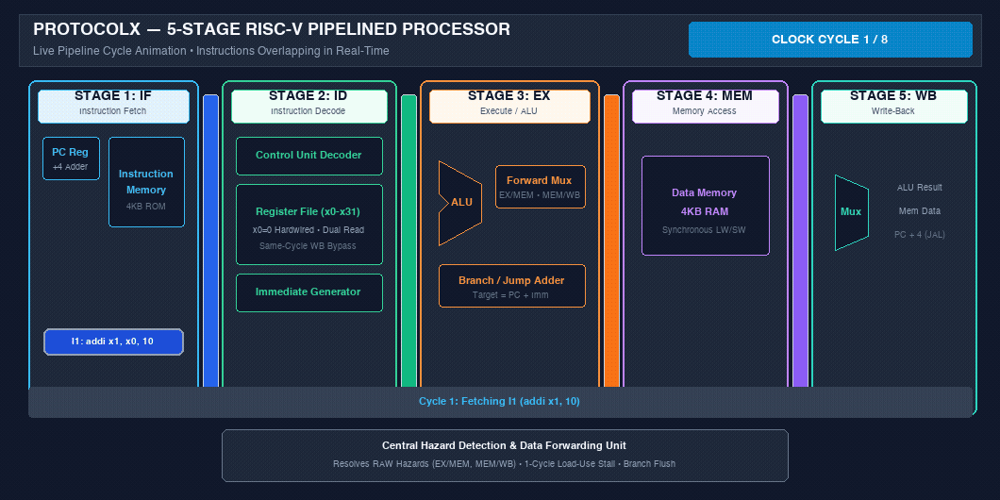

# ProtocolX — 5-Stage Pipelined RISC-V Processor

[](rtl/)
[](https://steveicarus.github.io/iverilog/)
[](docs/VERIFICATION_REPORT.md)
[](LICENSE)
[](docs/IEEE_Phase1_Project_Report.md)

Welcome to the **ProtocolX** repository! This is our college engineering project for designing, implementing, and verifying a 32-bit **5-Stage Pipelined RISC-V (RV32I) Processor** using Verilog HDL.

---

## 👥 The ProtocolX Team

| Roll Number | Name | Primary Role & Contributions |
|:---:|:---|:---|
| **2401020041** | **Naveen Kumar** | **Project Lead & Primary RTL Developer**<br>Core processor architecture, ALU, Register File, Immediate Generator, and top-level datapath integration. |
| **2401010032** | **Aditya Raj** | **Technical Lead, Pipeline Design & Verification**<br>Hazard detection unit, RAW data forwarding logic, testbench development, and simulation verification. |
| **2401010095** | **Archit Mamodiya** | **Literature Review & Research**<br>RISC-V specification analysis, comparative study of open-source academic cores, and literature review. |
| **2401020060** | **Shagun Vishnoi** | **IEEE Report & Documentation**<br>Authoring and formatting the IEEE Phase I report, compiling authentic academic citations, and documentation. |
| **2401010388** | **Ritik Ranjan** | **Architecture Diagrams, GitHub Docs & Video Preparation**<br>Creating SVG block diagrams, diagram guide, video presentation script, and video link coordination. |

---

## 🎯 Project Objective (Phase I)

The goal of Phase I was to build a working, hardware-accurate 5-stage pipelined processor implementing the base integer RISC-V instruction set (RV32I). 

Instead of waiting for one instruction to complete all its operations before starting the next one (single-cycle), our processor overlaps execution across 5 stages like an assembly line:

```
Clock Cycle:   1     2     3     4     5     6     7
Instruction 1: [IF]  [ID]  [EX]  [MEM] [WB]
Instruction 2:       [IF]  [ID]  [EX]  [MEM] [WB]
Instruction 3:             [IF]  [ID]  [EX]  [MEM] [WB]
Instruction 4:                   [IF]  [ID]  [EX]  [MEM] [WB]
Instruction 5:                         [IF]  [ID]  [EX]  [MEM] [WB]
```

---

## 🏗️ Processor Architecture & Live Pipeline Execution

<p align="center">
  
</p>

*Above: Live execution showing instructions overlapping across the 5 stages (`IF` $\rightarrow$ `ID` $\rightarrow$ `EX` $\rightarrow$ `MEM` $\rightarrow$ `WB`) with real-time data forwarding. For the static vector schematic, see [diagrams/protocolx_pipeline_architecture.svg](diagrams/protocolx_pipeline_architecture.svg) and the walkthrough in [diagrams/diagram_description.md](diagrams/diagram_description.md).*

### The 5 Pipeline Stages
1. **Instruction Fetch (IF):** Reads the 32-bit instruction from memory using the Program Counter (PC) and increments `PC = PC + 4`.
2. **Instruction Decode (ID):** Decodes the opcode and function fields, reads registers from the 32-entry Register File (`x0` is hardwired to 0), and sign-extends immediate values.
3. **Execute (EX):** The 32-bit ALU performs arithmetic, bitwise, shift, or comparison calculations. Branch addresses are computed here.
4. **Memory Access (MEM):** Reads from or writes to the 4KB Data Memory for `LW` and `SW` instructions.
5. **Write-Back (WB):** Selects between the ALU result, memory data, or `PC + 4` and writes back into the destination register (`rd`).

### The 4 Pipeline Registers
Between each stage sits a synchronous pipeline register that latches data and control signals on every clock tick:
- `pipe_if_id`: Holds instruction and PC. Can be stalled or flushed.
- `pipe_id_ex`: Holds register data, immediate, PC, and control signals. Can be flushed.
- `pipe_ex_mem`: Holds computed ALU result, store data, and memory control lines.
- `pipe_mem_wb`: Holds memory read data, ALU result, and writeback destination.

### 🛡️ How We Handle Hazards
- **RAW Data Hazards:** Resolved by the **Data Forwarding Unit**. If an instruction in EX needs a register calculated by an earlier instruction currently in MEM or WB, data is forwarded directly into the ALU input multiplexers without stalling.
- **Load-Use Data Hazard:** When an instruction immediately depends on data being loaded by `LW`, the data cannot be forwarded in time. Our **Hazard Unit** detects this, pauses the PC and IF/ID registers, and inserts a 1-cycle bubble (NOP).
- **Control Hazards:** When a conditional branch (`BEQ`, `BNE`, etc.) evaluates to true, instructions speculatively fetched along the wrong path are flushed (converted to NOPs).

---

## 📂 Repository Structure

```
protocolx-riscv-pipelined-processor/
├── rtl/                               # Verilog Source Files
│   ├── riscv_defines.vh               # Constants, opcodes, ALU operation codes
│   ├── riscv_core.v                   # Top-level 5-stage pipelined processor core
│   ├── alu.v                          # 32-bit Arithmetic Logic Unit
│   ├── reg_file.v                     # 32x32-bit Register File (x0=0, bypass)
│   ├── imm_gen.v                      # Sign-extending Immediate Generator
│   ├── control_unit.v                 # Instruction decoder & ALU control
│   ├── hazard_unit.v                  # Data forwarding & load-use stall logic
│   ├── execution_unit.v               # EX stage with forwarding muxes & ALU
│   ├── instruction_memory.v           # 4KB instruction ROM/RAM model
│   ├── data_memory.v                  # 4KB data RAM model
│   ├── pipe_if_id.v                   # IF/ID pipeline register
│   ├── pipe_id_ex.v                   # ID/EX pipeline register
│   ├── pipe_ex_mem.v                  # EX/MEM pipeline register
│   └── pipe_mem_wb.v                  # MEM/WB pipeline register
│
├── testbench/                         # Testbenches & Test Programs
│   ├── tb_riscv_core.v                # Full pipeline integration testbench
│   ├── tb_riscv_hazard.v              # RAW hazard forwarding testbench
│   ├── tb_riscv_mem.v                 # Load/Store & load-use stall testbench
│   ├── tb_riscv_branch.v              # Branch taken & flush testbench
│   ├── tb_alu.v                       # ALU unit testbench
│   ├── tb_reg_file.v                  # Register file unit testbench
│   ├── tb_hazard_unit.v               # Hazard unit testbench
│   └── programs/                      # Hex machine code test suites
│       ├── prog_arithmetic.hex        # Basic arithmetic instructions
│       ├── prog_hazard.hex            # RAW data hazard test program
│       ├── prog_load_store.hex        # Memory & load-use stall program
│       └── prog_branch.hex            # Branch condition test program
│
├── diagrams/                          # Architectural Diagrams
│   ├── pipeline_animation.gif         # Live animated GIF of 5-stage pipeline
│   ├── protocolx_pipeline_architecture.svg # Vector block diagram
│   ├── simulation_waveform_diagram.svg     # Timing and cycle waveform diagram
│   └── diagram_description.md         # Detailed diagram walkthrough
│
├── docs/                              # Project Documentation & Reports
│   ├── IEEE_Phase1_Project_Report.pdf  # Compiled IEEE Two-Column Conference PDF
│   ├── IEEE_Phase1_Project_Report.html # IEEE Conference Format HTML source
│   ├── IEEE_Phase1_Project_Report.md  # Official IEEE Phase I Report (Markdown)
│   ├── IEEE_Phase1_Project_Report.tex # IEEE Report LaTeX source file
│   ├── CONTRIBUTIONS.md               # Detailed individual team contributions
│   └── VERIFICATION_REPORT.md         # Test coverage & simulation audit
│
├── simulation/                        # Simulation Scripts & Real Logs
│   ├── run_sim.sh                     # Automated bash simulation runner
│   ├── simulation_results.log         # Real unabridged simulation log
│   ├── waveform.vcd                   # Core arithmetic VCD waveform
│   ├── waveform_hazard.vcd            # Forwarding test waveform
│   ├── waveform_mem.vcd               # Memory & stall waveform
│   └── waveform_branch.vcd            # Branch flush waveform
│
├── video/                             # Video Presentation Deliverables
│   ├── VIDEO_DEMO_SCRIPT.md           # 5-minute prototype presentation script
│   └── VIDEO_LINK.md                  # Video demonstration link placeholder
│
├── Makefile                           # Quick command runner
├── LICENSE                            # MIT License
└── README.md                          # Main project guide
```

---

## ⚡ Quickstart: Running Simulations

### Prerequisites
You need **Icarus Verilog** (`iverilog`) and **GTKWave** (optional, for viewing waveforms).
- On macOS (Homebrew):
  ```bash
  brew install icarus-verilog gtkwave
  ```
- On Ubuntu/Debian Linux:
  ```bash
  sudo apt-get install iverilog gtkwave
  ```

### Run All Verification Tests
To compile and run every unit test and full pipeline testbench in one go:
```bash
./simulation/run_sim.sh
```
Or simply:
```bash
make test
```

### Run Specific Testbenches
- **Top-level Pipeline Test:** `make test_core`
- **Data Forwarding Test:** `make test_hazard`
- **Memory & Stall Test:** `make test_mem`
- **Branch Flush Test:** `make test_branch`
- **ALU Unit Test:** `make test_alu`

### Viewing Waveforms
Open any of the generated `.vcd` files in GTKWave:
```bash
gtkwave simulation/waveform.vcd
```

---

## 📊 Verification Results (Phase I)

All 42 automated assertions passed with zero failures across seven testbenches:

```
================================================================================
           PROTOCOLX RISC-V 5-STAGE PROCESSOR - FULL VERIFICATION SUITE         
================================================================================

>>> 1. ALU Unit Test............................. [PASS 10/10]
>>> 2. Register File Test (x0 check & bypass).... [PASS  3/3]
>>> 3. Hazard Unit Test (fwd, stall & flush)..... [PASS  4/4]
>>> 4. Full Pipeline Arithmetic Program.......... [PASS 10/10]
>>> 5. RAW Data Hazard Forwarding Program........ [PASS  4/4]
>>> 6. Memory Load/Store & Load-Use Stall........ [PASS  6/6]
>>> 7. Branch Condition & Pipeline Flush......... [PASS  5/5]

--------------------------------------------------------------------------------
TOTAL ASSERTIONS: 42 | PASSED: 42 (100%) | FAILED: 0
================================================================================
```

A complete cycle-by-cycle execution trace can be found in [`simulation/simulation_results.log`](simulation/simulation_results.log).

---

## 📹 Video Demonstration

A 5-minute video presentation covering the project introduction, member roles, architecture walkthrough, Verilog code review, and live simulation is documented in [`video/VIDEO_DEMO_SCRIPT.md`](video/VIDEO_DEMO_SCRIPT.md).

- **Demonstration Video Link (Google Drive):**  
  👉 **[ProtocolX Phase I Prototype Video (Google Drive)](https://drive.google.com/drive/folders/11hZyntXJBju4w4UMHXSxqYusGwjAtXKI?usp=sharing)**  
  *(Also recorded in [`video/VIDEO_LINK.md`](video/VIDEO_LINK.md) and [`video/README.md`](video/README.md))*

---

## 🗺️ Project Status & Roadmap

### Completed in Phase I:
- [x] Full 5-stage pipelined datapath (IF, ID, EX, MEM, WB).
- [x] 4 Pipeline registers with stall and flush controls.
- [x] RV32I basic instructions (Arithmetic, Logic, Shifts, Comparisons, LW, SW, BEQ, BNE, JAL).
- [x] Hardware forwarding unit for RAW data hazards.
- [x] Hardware load-use stall unit (1-cycle bubble injection).
- [x] Control hazard pipeline flushes on taken branches.
- [x] Real simulation runs, testbenches, and waveforms.
- [x] IEEE Phase I Project Report and architecture diagrams.

### Pending / Planned for Phase II:
- [ ] Control and Status Registers (CSRs) for exception handling.
- [ ] Hardware timer and external interrupts.
- [ ] Dynamic branch prediction (2-bit saturating branch history table).
- [ ] RV32M hardware multiplier and divider extension.
- [ ] Synthesis and FPGA prototype demo on a Xilinx Artix-7 / Basys 3 board.

---

## 📄 License

This project is licensed under the [MIT License](LICENSE).
